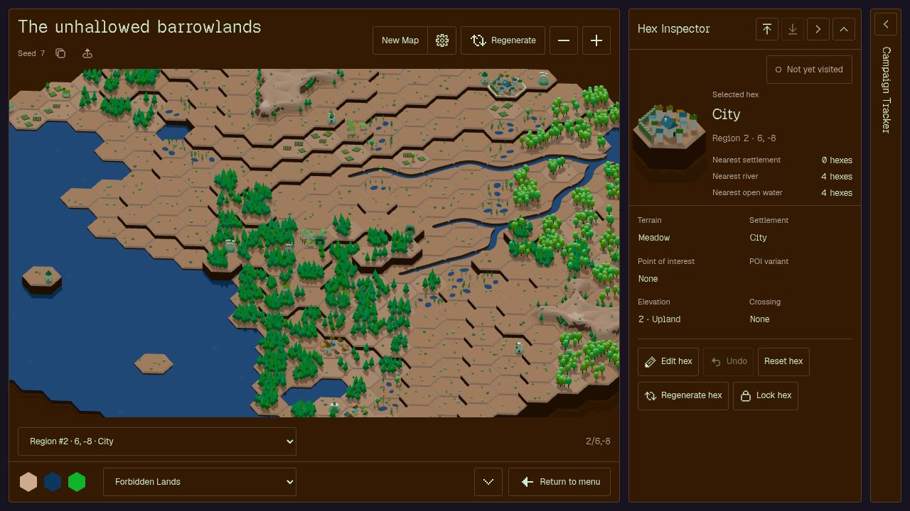

# Wilderness Almanac

**DM toolbox for sandbox RPG campaigns.**

Build a world, find a place worth exploring, and make it your own. Wilderness Almanac creates interactive hex maps with connected forests, mountain ranges, winding rivers, settlements and points of interest—all in a low-poly, isometric style.

**[Open Wilderness Almanac](https://wilderness-almanac.vercel.app)** · [Releases](https://github.com/ursusmeles/wilderness-almanac/releases) · [Report a bug or suggest a feature](https://github.com/ursusmeles/wilderness-almanac/issues)



## Your next unexplored world

- **Generate a campaign.** Each seed creates a named map of 469 hexes across six regions, with villages, towns, cities, ruins, dungeons and other places to discover.
- **Shape the map.** Use the Inspector to change terrain, elevation, settlements, points of interest and road exits. Regenerate a single hex, lock its dressing, mark it visited, or undo an edit.
- **Set the atmosphere.** Choose from nine palettes or make your own from three colours. The palette system keeps surfaces, water and props readable while preserving deep shadows and saturated accents.
- **Keep several adventures.** Name your campaigns, choose their tile icons and return to them from the campaign library.
- **Explore on desktop or mobile.** Pan and zoom, fold away the tool panels, or expand the map to fill the browser viewport. On mobile, both tool panels start closed below the map, with their headers visible on the first screen. Trees, reeds and water have optional ambient motion.

Opening a campaign prepares up to eight tile icons: four settlements and four points of interest. Hover over a campaign icon to show its refresh button, or tap the icon on touchscreens. Refresh cycles through these previews in order. You can also choose any hex with **Use as campaign icon** in the Inspector. Before previews are ready, the card shows a meadow tile in a fixed dusk-and-ember palette.

Wilderness Almanac is actively developing. The Inspector and party marker are functional; the Party panel includes its journal, oracle, dice rolls and abstract draws.

The party marker starts at the settlement nearest the map centre and saves its position with the campaign. Its starting hex and each placement become visited in the Inspector. Selecting the piece clears hex selection and opens the **Party panel**. Its editable name defaults to **Adventurers**. Click or tap the portrait to reveal colour and token-shape controls; the person icon cycles Warden, Waystone and Cairn. Metadata shows coordinates, nearby settlements and POIs, visited coverage, and the current Week, Day or Session (initially 1). Coverage excludes ocean/lake hexes and includes river-bank hexes. The compass button selects and focuses the party hex; map-pin buttons locate the nearest settlement/POI; the grid button selects all counted land hexes together. Selecting the piece highlights only its base and shows its name in the selection dropdown, where the party is always the first option. Drag and drop the party marker to move it on desktop or mobile, with fog on or off. On mobile, you can also select the party and tap a destination hex to confirm moving there. Tapping its current hex inspects that hex immediately. Cancel keeps the token in place and selects that hex instead. With the party selected, **Q / W / E** move to the three upper neighbours and **A / S / D** to the three lower neighbours. Key labels appear on adjacent hexes while using the keyboard. Movement marks the destination visited and works with fog on or off. Moving leaves the map view in place. **Find party** selects the party and centres the map on it, showing roughly five hexes across.

## Party Journal

Select the party token to open its **Party panel**, combining metadata and the journal in one panel. Edit its name in the title bar; the calendar icon opens the current period below. Movement and party renaming are recorded automatically. The journal controls show one period at a time; the final page offers **Start new week**, **Start new day** or **Start new session**, with writing and rolls disabled until it begins. Starting it records that the party lived another period; the Inspector and campaign card show the same number. Selecting a hex restores **Inspector** and **Journal**; the latter is reserved for a later update.

Write notes of up to 300 characters and choose **Add to Journal** (or press Enter; Shift+Enter adds a line). Type `@` to mention the party, `#` for a Week, Day or Session, or `$` to search hexes by coordinates or name; visited hexes appear first. Use the arrow keys and Tab to complete a suggestion, or tap it. Entries keep their original names after renaming. Time mentions open that period’s page; hex mentions use the Inspector’s description. Older entries in a week load as you scroll up. Hover over an entry, focus it with the keyboard, or tap it to reveal Copy, plus Reroll for dice, oracle and abstract entries or Edit for manual notes. Manual notes and rolls also offer Delete; automatic movement, rename and week entries cannot be deleted. Travel messages show the destination’s description without coordinates. You can add and edit notes on earlier week pages.

Type `/help` for temporary command help, which disappears after the next logged event. `/clear` dismisses help and removes dice, abstract and oracle results without attached notes or questions across all weeks; it adds no entry. Oracle questions and manual notes remain. `/oracle [modifier] [question]` rolls a d6 oracle, clamped to 1–6 after modification: No, and… / No / No, but… / Yes, but… / Yes / Yes, and…. `/abstract` draws one of the 22 Major Arcana. Dice commands support d4, d6, d8, d10, d12 and d20 with addition and subtraction; `/2d6+1 4d6 1d20` makes three separate rolls, showing individual results and totals. Typing `/` suggests help, clear, abstract, explore and oracle, followed by the supported dice. The input can be resized vertically from its usual minimum height. The three buttons above it offer the same actions; **Explore hex** is reserved for a later update and currently does nothing.

Journals save locally with the campaign and travel with JSON exports and optional account copies. Each period initially displays its 50 most recent entries, then loads older entries in batches. Each campaign supports up to 20,000 entries; import/export and account transfers have a 16 MB limit. Recovery downloads preserve raw stored data separately.

For a small testing map, create a campaign with seed **`heliotest`**. It has seven hexes: a central town and, clockwise from north, mountains with a nest, dense pine forest, light ash forest with an abbey, open water, meadow, and vineyards with an encampment. Their elevations are 4, 3, 2, 0, 0 and 1; the town is at 1.

## Getting started

Open the app and choose **New campaign** to preview a map, adjust open water, elevation, forests and settlements, choose a palette and name your campaign, then select **Create campaign**. Choose **Generate preview** after changing the seed or world preferences, or choose **Keep current map** to restore the preview settings. You can also import a previously exported campaign JSON file. Campaigns open with the party’s hex selected and centred. On desktop, new campaigns start with Inspector above Journal, both open. Settings lets you swap their order on desktop and mobile. The vertical handle at the map’s right edge resizes both columns; drag toward the right edge to fold the tools into rails. Double-click it to toggle folded tools and the default layout. Column widths and panel heights are remembered per campaign in this browser. The handle between tools resizes their heights; double-click toggles the top tool between its default height and title bar, returning an oversized tool to default first. On mobile, title-bar buttons open or close each panel. Panels follow the page scroll without resize handles; long journal logs scroll within the panel and let the page continue scrolling at either end. Click another hex to inspect and edit it. Drag to pan, or press an **arrow key** to jump the view two hexes. Use the zoom controls, mouse wheel or **+ / −** keys to look closer. On mobile, pinch or double-tap and hold the second tap, then slide down to zoom in or up to zoom out.

Open **Settings** using the gear in the main menu to choose the default palette and time of day for new campaigns, choose Week, Day or Session as the campaign time increment, set Inspector/Journal order, turn Movement on or off, or choose a campaign JSON file to import. The Movement, time of day, time increment and top panel options use segmented toggles. Changes and imports take effect when you choose **Save**; **Cancel**, the close button, Escape or clicking outside Settings discards them. New installations start with **Forbidden Lands** and **Dawn**. Existing campaigns keep their saved palette and lighting. The time increment defaults to **Week** and applies to all campaigns in this browser. Changing it updates metadata, journal pages, mentions and automatic period messages without changing numbers: Week 3 becomes Day 3 or Session 3. Campaign cards show the selected increment, starting at 1.

Choose **Manage palettes** in Settings to add palettes, edit their three colours or rename them. Palette-manager changes save immediately. Choosing a different default also colours the main menu; Forbidden Lands keeps the original menu theme. Bundled palettes stay read-only. Deleting a custom palette keeps existing campaigns’ colours; deleting the default restores Forbidden Lands. **Undo deletion** restores the palette. Palettes save in this browser alongside your settings.

Choose **Multiselect** in the first button row of the Inspector to edit several hexes together. You can also **Ctrl+click** (**Cmd+click on Mac**) a map hex to turn multi-edit on, keeping the inspected hex selected and adding the clicked hex. Once multiselect is on, click or tap hexes to add or remove them; **Ctrl** or **Cmd** clicks work the same way. On mobile, hold an unselected hex to add it to your selection and turn multi-edit on. The coordinate selector toggles hexes while multi-edit is on, and the Inspector offers **Select all** and **Clear selection**. Choose only the fields you want to change, then apply to the selection. One **Undo** restores the entire batch. Open water removes settlements and POIs; incompatible edits leave the whole batch unapplied. Choose **Turn off multiselect** beside Clear selection to return to the single-hex Inspector. Journal stays closed while multiselect is on and restores its previous layout when you turn multiselect off.

The palette picker includes **Save as new palette…**. Choose it to name and save the current colours in a modal; an existing custom name offers to update that palette.

The **Point of interest** field includes named choices such as **Mystic · Portal**. Cosmetic model variations are chosen by **Regenerate hex**. Other edits preserve the current variation.

Select connected town or city hexes to **Join town** or **Join city**. Villages always occupy one hex each.

In Multiselect, **Reset selected**, next to Undo, restores the selected hexes to their generated defaults after confirmation. It clears their edits, visited status and dressing locks. Undo restores the reset hexes.

On current maps, mountain ranges mix rounded ridges with occasional taller, steeper crests. Farmland shows dense golden wheat fields spreading toward hex edges, with occasional vineyards on raised tiles. Some farmland trees bear colourful fruit. Choose Farmlands or Vineyards in Edit or Multiselect. They remain cosmetic variants: regeneration can switch between them, and locks preserve them.

**Regenerate map**, in the expanded appearance panel, changes the map's cosmetic dressing while keeping its geography and locations. Create a different world through **New campaign** in the main menu. Hexes with locked dressing keep their appearance through map-wide regeneration.

New campaigns include subtle roads connecting settlements, crossings and selected points of interest. Roads favour open terrain, avoid mountains and use existing bridges and ferries. Regenerate changes their shape while keeping their routes. The Inspector lists road exits clockwise as N, NE, SE, S, SW and NW. In **Edit hex**, use the **Road exits** checkboxes to connect neighbouring hexes; unavailable exits explain their terrain restriction. Ordinary terrain with three or more exits is labelled “with crossroads”. Manual roads can extend beyond the generated road budget. Adding a settlement or POI leaves roads unchanged; removing a destination removes its generated links without rerouting other roads. Existing campaigns keep their original maps.

The appearance panel starts closed whenever you enter a campaign. On mobile, opening it keeps the compact palette controls in place and adds Movement and Regenerate underneath, without shrinking the map. Its **Time** button cycles through **Dawn → Day → Dusk → Night**, using a sun for dawn/day and a moon for dusk/night. Dawn is brighter and rose tinted, dusk has warm orange light and long shadows, and night is dark navy. At dusk and night, buildings glow yellow, mystic sites glow violet-blue, and dungeon/mine entrances glow red. Each building casts its own stronger glow, pulsing independently between 40% and full brightness. Prominent lighthouse beams reach up to two hexes and sweep across a broad arc where visible open water allows, ending in a soft round glow on the water. **Movement ON/OFF** controls wind, water waves, light pulses and lighthouse sweeps. Reduced-motion settings pause them too. Day has 20% stronger wind sway and more frequent gusts; dawn, dusk and night keep their gentler wind. Each campaign remembers its time of day, including in JSON exports; older campaigns start in Day mode.

### Fog of War

Turn **Fog of war ON** in the map header (top-right of the map on mobile) to show a player-facing view of your campaign. Visited hexes stay coloured, visible but unvisited hexes turn grayscale, and undiscovered hexes become blank tiles. Hidden hexes show only their coordinates and “Undiscovered hex”. Visited hexes reveal a one-hex radius, increasing to two at elevation 3 and three on mountains/elevation 4. Towns/cities and watchtowers/lighthouses/strongholds each add one, stacking to five for a mountain town with a watchtower. High terrain blocks sight, while open water reached within normal sight reveals the first far shore. From an inland hex, each elevation level above 1 adds one hex of reach to open water over lower land; equal or higher terrain blocks this extra view. The extra reach reveals water without uncovering intervening land or additional shores.

Move the party or mark hexes visited to uncover the map. You can also mark visited hexes as unvisited, including in multi-edit; this can hide areas again. Fog remembers its setting per campaign. Turn it off to edit terrain, features or dressing. Undo for visits and party moves is available in Multiselect. Single-hex Undo appears after choosing Edit.

Fog is for presenting the current screen. Seed links from the campaign list recreate the full map; campaign exports remain complete GM backups, including edits and visited flags.

### Saving and sharing

Short tooltips clarify ambiguous controls and unavailable actions on hover, keyboard focus or tap. On mobile, brief messages on the map confirm actions and report errors.

Use the back arrow beside the map title or your browser’s Back button to return to your campaigns. Browser Forward reopens the campaign, and unsaved Inspector edits are protected. Seeds, seed copying and map sharing are available in the campaign list.

Campaigns save automatically **in your current browser**. There are no accounts or cloud sync. Export campaign JSON to back up your work or move it between computers; clearing browser storage can remove local campaigns.

- **Share map** in the campaign list copies a link with the seed, world preferences, generator version, dressing variant and palette. It recreates the generated map, but does **not** include your hex edits or visited status.
- **Export campaign** downloads the complete campaign replay record, including edits and dressing locks. Import it on another device to continue working.

If saving fails, a persistent warning offers **Retry saving** and **Download unsaved data**; the map also offers **Download campaign**. Changes from another browser tab can require downloading your work before reloading. Saved data this version cannot read is preserved; **Download recovery file** backs up stored data. Keep recovery files for troubleshooting or a compatible app version; they are separate from individual campaign exports. The app requests persistent browser storage where supported, but regular exports remain your backup.

Exports are named `wilderness-almanac-[campaignname]-[YYYY-MM-DD].json`. Replay files depend on their generator version; unsupported versions are rejected rather than silently producing a different map.

Self-hosted deployments can enable **Account & sync** to sign in with an emailed code and save or load account copies. Work still saves in this browser, including offline. Conflicting edits are kept for you to resolve; **Import as copy** preserves both versions. JSON export/import remains available. See the [self-hosting guide](docs/SELF_HOSTING.md) to enable this option.

## Run locally

You need [Node.js](https://nodejs.org/) 24 or later. The repository includes an `.nvmrc` for Node 24.

```sh
git clone https://github.com/ursusmeles/wilderness-almanac.git
cd wilderness-almanac
npm ci
npm run dev
```

Open the address printed in your terminal. No backend, API keys or environment variables are needed. To make a production build, run `npm run build`; `npm run preview` serves it locally.

## Contributing

Bug reports, map examples and feature ideas are welcome in [GitHub Issues](https://github.com/ursusmeles/wilderness-almanac/issues). For map-related reports, include the seed and a screenshot; an exported campaign is helpful when the issue involves edits.

For the code structure, development checks and save format, see the [development guide](docs/DEVELOPMENT.md). [Project state](docs/PROJECT_STATE.md) explains the generation rules, visual constraints and current limits.

## License and credits

Wilderness Almanac is licensed under the [GNU Affero General Public License v3.0](LICENSE).

Built with [Three.js](https://threejs.org/) and [Vite](https://vite.dev/). The interface uses [Geist Sans and Geist Pixel Square](public/fonts/OFL.txt) under the SIL Open Font License, and a small [Pixelarticons](public/icons/README.md) subset under the MIT License. Map generation draws inspiration from [Red Blob Games](https://www.redblobgames.com/maps/mapgen4/), with a visual direction inspired by Thronefall.
